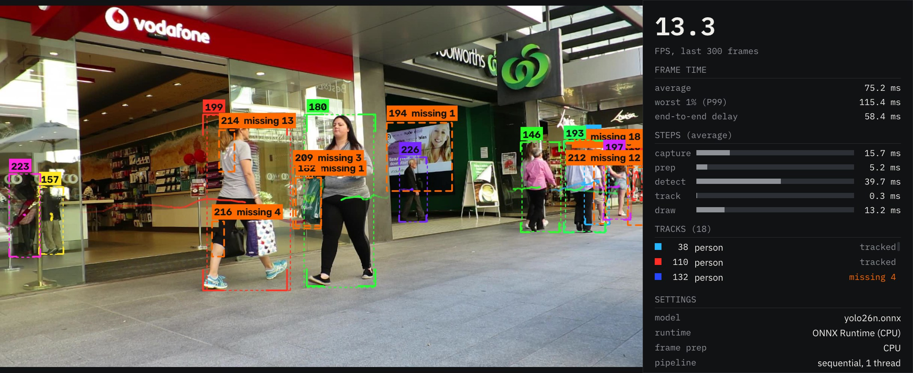

# Tether

Real-time multi-object tracker in C++ that keeps stable IDs on fast-moving and temporarily blocked objects.

[](docs/media/demo-mot17-09.mp4)

*MOT17-09, recorded with `tether-pipeline --record` in the shipped configuration. Click for the full video. Each person gets a colour and an ID; the trail is where they've been and the thin dashed box is where the tracker expects them next. A thick orange dashed box is a person the detector lost, which the tracker is still searching for. Video: [MOT17](https://motchallenge.net/data/MOT17/) (CC BY-NC-SA 3.0).*

## In short

Tether follows moving objects in video, people or drones, and keeps a steady ID on each one, even when it's briefly hidden or the detector misses it for a moment. It runs in real time on a laptop GPU. It's a portfolio project, built and measured on one laptop, not a product.

**What works**
- **It's fast.** About 195 frames per second on a video file, against a goal of 120. A typical camera sends 30.
- **It tracks people as well as a widely used open-source tracker.** On MOT17, the standard pedestrian benchmark, it matches ByteTrack on all three agreed scores at the settings it ships with.
- **The new drone detector finds drones at the site it was trained on.** On new flights there, it spots the drone in 88.4% of frames, and 97.5% of what it flags really is a drone. The general-purpose detector it started from spotted 22.2%.

**What doesn't, yet**
- **Holding on to a drone's ID.** When detections drop out, it keeps the drone's ID less often than its goal: 84.0% against 89.3% when a fifth of the detections are deleted on purpose, and 75.3% with the drone detector's own detections, short of that test's goal too.
- **The drone detector only knows one place.** On drone photos from other sources it does worse than the detector it started from, and it mistakes some birds and a lamp for drones.
- **A few goals weren't met or measured.** The delay on a live webcam hasn't been measured in the final setup, and a folder of JPEG images runs below the speed goal because decoding the images is the bottleneck.

Every goal, met or missed, is in the [scorecard below](#targets-what-was-met-and-what-wasnt). The story behind each result is in [LESSONS.md](docs/LESSONS.md).

## What it is

A pretrained YOLO26n detector finds objects in each frame, and a hand-written tracker links them over time: a Kalman filter predicts where each object goes next, staged Hungarian matching pairs detections with those predictions, and a track lifecycle (tentative → tracked → searching → removed) keeps an ID alive through short blockages.

It was built in two passes. A Python prototype got the tracking logic right; then a C++ port reproduced it exactly (same IDs and statuses on every frame of 462 real detection files) and moved it onto an NVIDIA GPU: TensorRT for the model, a custom CUDA kernel for frame prep, and parallel pipeline stages. A live HUD draws the tracks and a stats panel shows FPS, worst-case frame time and end-to-end delay.



Every claim below comes from a committed write-up in [`docs/benchmarks/`](docs/benchmarks/), which has the setup, the raw tables and the caveats. Measured on one laptop (AMD Ryzen AI 7 350, RTX 5070 Laptop GPU), Windows, headless, two rounds per timing unless noted.

## Targets: what was met and what wasn't

The spec ([docs/SPEC.md](docs/SPEC.md#targets)) set these goals up front. Speed targets are for the shipped configuration: YOLO26n at 1280×736 on TensorRT with CUDA frame prep and the parallel pipeline.

| Target | Result | Met? |
|---|---|---|
| 120+ FPS on video files | 195.45–195.86 FPS on the Anti-UAV video clip; 65.46–65.67 on MOT17-04, a folder of JPEGs | Video file yes; JPEG folder no (decoding the JPEGs is the limit) |
| Worst 1% frame time (P99) under 16 ms | 6.49–6.57 ms on the Anti-UAV clip; 20.00–20.09 ms on MOT17-04 | Video file yes; JPEG folder no |
| Webcam end-to-end delay under 50 ms, zero dropped frames | Not measured in the shipped configuration. At 640 on ONNX Runtime (CPU), parallel dropped 0 frames in 300 but had 83 ms delay; sequential had 37 ms but dropped 129 | Unknown |
| MOT17: HOTA within 2 points of ByteTrack, IDF1 ≥, ID switches ≤ | 1280×736: all three. 640: HOTA and ID switches yes, IDF1 0.3 behind | Yes at the shipped size |
| Anti-UAV, 20% of detections deleted: ID kept ≥ 95% of the reachable ceiling | 84.0% against a target of 89.3% (0.95 × the 94.0% ceiling) | **No**, 5.3 points short |
| Anti-UAV, gaps up to 1 s: ID recovered ≥ 80% | 88.9% | Yes |
| Tracking step, C++ vs Python: 10×+ | 14.1× (MOT17), 35.0× (Anti-UAV) | Yes |
| Whole pipeline, C++ vs Python: 2×+ | 1.08–1.20× | **No**: both run the same CPU detector, which dominates |
| Parallel vs sequential: 1.5×+ | 1.57× on MOT17-04, 1.23–1.24× on the Anti-UAV clip (640, ONNX Runtime) | Partly: the Anti-UAV clip was already at the detector's ceiling |
| CUDA vs CPU frame prep: 3×+ on that step | 9.19–9.21× in the shipped configuration; 2.74–2.78× in one other (MOT17-04 at 640, sequential) | Yes where it ships |
| TensorRT vs ONNX Runtime: 1.5×+ on the model run | 5.15–5.63× at 640, 10.01–10.44× at 1280×736 | Yes, but it's GPU against CPU (see below) |
| Python and C++ trackers give matching outputs | Same IDs and statuses on every frame of 462 real files | Yes |
| Drone model on Anti-UAV test, at its frozen threshold: recall ≥ 0.80, precision ≥ 0.90 | Recall 0.884, precision 0.975 | Yes |
| Drone model end to end: ID kept ≥ 0.95 × the labeled-box row on the same test clips | 75.3% against 82.6% on the labels (0.911×) | **No** |
| Drone model false alarms: ≤ 8 of 86 bird images, ≤ 4 detections in 2.25 min of empty sky | 19 of 86 birds; 190 detections, 174 of them on one lamp | **No** |
| Drone model transfer: Seraphim AP50 above the COCO model's 0.216 | 0.164 | **No** |
| Drone model speed in the shipped configuration (120+ FPS, P99 under 16 ms) | 195.59–198.63 FPS, P99 6.46–6.49 ms on an Anti-UAV val clip | Yes |

## Benchmarks

### MOT17: Tether vs ByteTrack

Both trackers read the same YOLO26n detections (score ≥ 0.1) and apply their own thresholds. 7 MOT17 train videos, scored with [TrackEval](https://github.com/JonathonLuiten/TrackEval). From [mot17-bytetrack.md](docs/benchmarks/mot17-bytetrack.md) and [antiuav-duplicates.md](docs/benchmarks/antiuav-duplicates.md) (the current default, reproduced in Docker).

| Tracker | Detections | HOTA | IDF1 | ID switches |
|---|---|---|---|---|
| **Tether** | YOLO26n @ 1280×736 (shipped) | **41.46** | **49.38** | **732** |
| ByteTrack | YOLO26n @ 1280×736 (shipped) | 40.86 | 48.63 | 800 |
| Tether | YOLO26n @ 640 | 33.13 | 37.62 | 529 |
| ByteTrack | YOLO26n @ 640 | 33.46 | 37.91 | 549 |

**Why two detection sets.** MOT17 frames are 1920×1080; at 640 input people shrink 3×, and the detector found only 33.7% of them, which left the trackers little to differ on. At 1280×736 it finds 54.6% at similar precision (84.3% against 85.4%), so 1280×736 is the headline ([ADR 0002](docs/adr/0002-mot17-benchmark-detections-yolo26n-1280.md)). It was benchmark-only at first; once TensorRT and CUDA prep made it fast enough, it became the shipped detector too ([ADR 0003](docs/adr/0003-ship-yolo26n-1280x736.md)). 640 is kept as a second row because it shows a different result: Tether slightly behind on HOTA and IDF1.

**Caveat.** These 7 videos are also the ones the tracker's settings were tuned on; there's no held-out split. Read it as "matches ByteTrack", not "beats" it. ByteTrack is Ultralytics' BYTETracker with its default settings, not the paper's MOT17 tuning.

### Anti-UAV: keeping the drone's ID through dropouts

Detections are the labeled drone boxes with failures added on purpose, so this tests the tracker, not the detector. An ID only counts as kept if its box overlaps the drone with IoU ≥ 0.5. 91 test clips, run once at the end; settings were tuned on val. From [antiuav-dropout.md](docs/benchmarks/antiuav-dropout.md).

| Test | First tracker (#8) | Final | Target |
|---|---|---|---|
| Nothing deleted, ID kept | 37.6% | 82.6% | — |
| 20% of boxes deleted at random, ID kept | 26.1% | **84.0%** | ≥ 89.3% (95% of the 94.0% ceiling): **missed** |
| 0.25 s gaps recovered | 68.5% | 91.5% | — |
| 0.5 s gaps recovered | 48.3% | 87.9% | — |
| 1 s gaps recovered | 27.2% | **88.9%** | ≥ 80%: met |

The target is relative to a ceiling because a track forgotten after its 30-frame search must take a new ID, so even a perfect tracker can keep only 94.0% on test ([antiuav-ceiling.md](docs/benchmarks/antiuav-ceiling.md)). Most of the remaining gap is re-association: an oracle that knows there's only one drone reaches 93.3% on val, but a general rule that gets there hasn't been found ([antiuav-single-target.md](docs/benchmarks/antiuav-single-target.md)).

### Drone detection: a drone-only detector, tested once

The standard detector was never trained on drones. Stage 5 trained a separate drone-only version, `yolo26n_drone_1280x736`, on footage from one test site (Anti-UAV). Its pass marks were set before anyone looked at the final test footage, and the final test was run once, so the results couldn't be tuned to it ([ADR 0004](docs/adr/0004-drone-detector-on-anti-uav.md), [drone-test.md](docs/benchmarks/drone-test.md)).

What it can claim:
- **It finds drones at that site.** On new flights filmed by the same camera, it spots the drone in 88.4% of frames, and 97.5% of what it flags is a drone. The general-purpose detector it started from (`yolo26n_1280x736`, counting anything it found as a drone) spotted 22.2%, and 75.7% of its flags were right.
- **It's fast enough for real time.** 195.59–198.63 frames per second on one laptop GPU (RTX 5070 Laptop), measured on one clip.

What it can't claim yet:
- **Keeping the drone's ID.** Tracking from its own detections, it keeps the drone's ID on 75.3% of test frames. The pass mark was 95% of what the same tracker gets from the hand-labeled boxes (82.6%), and it fell short.
- **Ignoring things that aren't drones.** It flagged a drone in 19 of 86 bird photos. In 2.25 minutes of empty sky at the site it made 190 false detections, 174 of them on one lamp in a night clip.
- **Working anywhere else.** On a mixed set of drone photos from other sources (Seraphim), it scored below the untrained detector: 0.164 against 0.216 on the standard detection score (AP50).

So it's the detection and tracking part of a drone-defence system, measured on one site's footage, not a drone-defence system.

### Python vs C++

The tracking step alone, median of 5 runs, outputs checked equal ([cpp-tracking-speed.md](docs/benchmarks/cpp-tracking-speed.md)):

| Input | Python ms/frame | C++ ms/frame | Speedup |
|---|---|---|---|
| MOT17 train (7 videos) | 2.521 | 0.1785 | **14.1×** |
| Anti-UAV test (91 clips × 5 conditions) | 0.172 | 0.0049 | **35.0×** |

The whole pipeline, both on ONNX Runtime's CPU provider, one run per video ([cpp-pipeline-speed.md](docs/benchmarks/cpp-pipeline-speed.md)):

| Video, input | Python FPS | C++ FPS | Speedup |
|---|---|---|---|
| Anti-UAV clip, 640 | 22.0–23.3 | 25.1 | 1.08–1.14× |
| MOT17-04, 640 | 16.7 | 19.6 | 1.17× |
| MOT17-04, 1280×736 | 8.6 | 10.4 | 1.20× |

The gap between the two tables is [Amdahl's law](docs/CONCEPTS.md#amdahls-law): the detector is 66–83% of a C++ frame and it's the same call in both languages, so even a C++ pipeline whose other steps were free would be at most 1.27–1.76× faster.

### Sequential vs parallel pipeline

Capture, prep, detect and track each on their own thread with one-frame queues between them. YOLO26n at 640 on ONNX Runtime (CPU). Tracks are the same: recordings came out byte-identical between modes ([parallel-pipeline.md](docs/benchmarks/parallel-pipeline.md)).

| Video | Sequential FPS | Parallel FPS | Speedup | End-to-end delay |
|---|---|---|---|---|
| Anti-UAV clip | 24.2–24.4 | 30.0–30.1 | 1.23–1.24× | 37 → 159 ms |
| MOT17-04 | 19.3 | 30.3 | 1.57× | 38 → 147 ms |
| Laptop webcam (30 FPS) | 20.9, 129 of 300 frames dropped | 29.9, 0 dropped | | 37 → 83 ms |

Parallel trades delay for throughput: frames wait in the queues before the detector. Both video runs are at the ceiling, since the frame time settles at the detect time (about 33 ms).

### CPU vs CUDA frame prep

One CUDA kernel letterboxes, reorders and scales each frame, and hands the result to TensorRT without a trip through the CPU. Its input is bit-identical to CPU prep's on 1920×1080 frames. YOLO26n at 1280×736, TensorRT, parallel ([cuda-prep.md](docs/benchmarks/cuda-prep.md)):

| Video | Prep ms (CPU → CUDA) | Prep speedup | FPS (CPU → CUDA) | P99 frame time ms |
|---|---|---|---|---|
| **Anti-UAV clip** | 7.83–7.90 → 0.85–0.86 | **9.19–9.21×** | 126.63–127.71 → **195.45–195.86** | 9.00–9.08 → **6.49–6.57** |
| MOT17-04 (JPEGs) | 7.37–7.46 → 1.20–1.23 | 6.00–6.21× | 64.37–64.94 → 65.46–65.67 | 20.93–22.18 → 20.00–20.09 |

On MOT17-04 FPS barely moves: decoding the JPEGs was already the slowest stage. Sequentially, CUDA prep saves 9.08–9.19 ms a frame on the Anti-UAV clip.

### ONNX Runtime vs TensorRT

The model run (`detect`), same float32 model, sequential, headless ([tensorrt-runtime.md](docs/benchmarks/tensorrt-runtime.md)). Every detection scoring ≥ 0.25 in one runtime had a partner in the other, scores at most 0.00032 apart.

| Input | ONNX Runtime (CPU) ms | TensorRT ms | Speedup |
|---|---|---|---|
| 640 | 32.77–33.33 | 5.84–6.46 | 5.15–5.63× |
| 1280×736 | 72.68–76.26 | 7.07–7.36 | 10.01–10.44× |

**Caveat.** This is GPU against CPU; ONNX Runtime's CUDA provider wasn't tried, so most of the gain is the GPU, not TensorRT's compilation. Replaying the engine from a CUDA graph roughly halves TensorRT's detect again at 640 (2.10–2.24×, [cuda-graph.md](docs/benchmarks/cuda-graph.md)); that's on by default.

### Model size × input size

YOLO26 n, s and m at two input sizes, all on TensorRT, parallel, CPU prep, on the Anti-UAV clip; MOT17 accuracy from the same engines ([model-size.md](docs/benchmarks/model-size.md)):

| Model | Input | FPS | P99 ms | Slowest stage | HOTA | IDF1 | ID switches |
|---|---|---|---|---|---|---|---|
| n | 640×640 | 141.80–186.27 | 6.77–9.47 | capture | 32.74 | 37.05 | 541 |
| s | 640×640 | 149.54–185.11 | 6.99–8.86 | capture | 37.81 | 43.28 | 503 |
| m | 640×640 | 105.43–106.05 | 11.17–11.31 | detect | 38.72 | 44.70 | 493 |
| **n (shipped)** | **1280×736** | **124.82–126.18** | **9.17–10.45** | **prep** | **41.55** | **49.33** | **772** |
| s | 1280×736 | 108.89–110.06 | 10.99–11.08 | detect | 44.86 | 52.30 | 707 |
| m | 1280×736 | 46.77–47.20 | 24.46–24.62 | detect | 46.90 | 54.77 | 700 |

n at 1280×736 is the most accurate row that meets both speed targets. Input size matters more than model size: n at 1280×736 beats m at 640. Its slowest stage was CPU prep, which is what made the CUDA prep kernel worth writing (195.45–195.86 FPS with it, above). s and m at 1280×736 are more accurate but stay under 120 FPS; FP16 engines, which might change that, weren't tried.

### Reproduced in Docker

The Docker image ran every benchmark with one command in 45.7 minutes, and every accuracy number (MOT17 for both trackers on both detection sets, detector recall, every Anti-UAV score) matched the write-ups exactly. Timings differ, as expected on a different OS and TensorRT version: 256.72–259.71 FPS for the shipped configuration, inside WSL 2 on the same laptop ([docker-reproduction.md](docs/benchmarks/docker-reproduction.md)).

### Known limitations

The full list, with numbers, is in [LESSONS.md](docs/LESSONS.md#honest-limitations). The ones most worth knowing:

- **MOT17 is tuning data.** No held-out split, so the ByteTrack comparison is a "matches", not a "beats".
- **Sparse scenes can swap IDs.** With nobody else around, a person who walks out can hand their ID to a similar-size newcomer within about a second. Fixing it properly needs appearance re-ID ([edge-rule.md](docs/benchmarks/edge-rule.md)).
- **The shipped configuration is opt-in.** The defaults stay ONNX Runtime on the CPU, CPU prep and sequential, so Tether runs without a GPU, but there the 1280×736 model is slow (11.9 FPS sequential on the Anti-UAV clip). Without a GPU, use the 640 model.
- **One machine.** All timings come from one laptop and one GPU; the CUDA kernel is compiled for that GPU's architecture by default.

## Build and run

### Python prototype

```
pip install -e .[test,demo]
tether-track detections.jsonl tracks.jsonl
pytest
```

#### Live demo

The demo runs pretrained YOLO26n through ONNX Runtime. Export the model once:

```
pip install -e .[demo,export]
python tools/export_model.py
```

That's `models/yolo26n_1280x736.onnx`, the shipped detector and the default of every tool that takes a model ([ADR 0003](docs/adr/0003-ship-yolo26n-1280x736.md)). On ONNX Runtime's CPU provider it's slow: detect takes 2.20–2.29× as long as at 640 (72.68–76.26 against 32.77–33.33 ms, `docs/benchmarks/tensorrt-runtime.md`). For a CPU-only machine or a live webcam, export the 640 model too (`python tools/export_model.py --size 640`, giving `models/yolo26n.onnx`) and pass `--model models/yolo26n.onnx`.

Then point it at a webcam index or a video file. Press `q` or Esc to stop.

```
tether-demo 0
tether-demo clip.mp4
```

`--dump detections.jsonl` skips the tracker and saves every detection down to `--det-min-score` (default 0.1). The tracker applies its own threshold (`--min-score` on `tether-track`, default 0.25), so other trackers can be run on the same file.

The detection and track file formats are in [docs/FORMATS.md](docs/FORMATS.md).

#### MOT17 evaluation

Download and unzip [MOT17](https://motchallenge.net/data/MOT17/) (`MOT17.zip`), then:

```
pip install -e .[demo,eval]
tether-mot17 path/to/MOT17
```

This scores the tracker on the 7 MOT17 train videos with TrackEval (HOTA, IDF1, ID switches) and saves per-video and combined results to `results/mot17/trackers/tether/results.json`. Detections are dumped once to `results/mot17/detections/<model>/` and reused, so every tracker sees the same input; `--model` picks another model, which gets its own folder. Any tracker that reads a detection file and writes a track file can be scored with `--tracker "<command>" --name <name>`; it's run as `<command> DETECTIONS TRACKS`.

The ByteTrack baseline (Ultralytics' BYTETracker) is scored on the same detections:

```
pip install -e .[bytetrack]
tether-mot17 path/to/MOT17 --tracker tether-bytetrack --name bytetrack_yolo26n_1280x736
```

Its tests (`python/tests/test_bytetrack.py`) are skipped unless the `bytetrack` extra is installed.

`python tools/detector_recall.py path/to/MOT17 results/mot17/detections/<model>` scores the detections alone, the ceiling for any tracker.

### C++ (Windows native)

The same tracker in C++ (`cpp/`), reading and writing the same files. It needs CMake 3.20+ and a C++20 compiler (MSVC 2022 on Windows; GCC 13 on Linux also builds it). The first configure downloads the pinned test framework and JSON library.

```
cmake -S cpp -B cpp/build
cmake --build cpp/build --config Release
ctest --test-dir cpp/build -C Release
```

`cpp/build.sh` runs all three. On Windows, Visual Studio 2022 ships CMake under `Common7/IDE/CommonExtensions/Microsoft/CMake/CMake/bin` if it isn't on your PATH. The CLI takes the same options as the Python one, except the diagnostic `--single-target`:

```
cpp/build/Release/tether-track detections.jsonl tracks.jsonl --confirm-frames 3
```

The whole pipeline, with the HUD (`--show`) and a recording of it (`--record`):

```
cpp/build/Release/tether-pipeline clip.mp4 --show --record out.mp4
```

#### TensorRT and CUDA frame prep

`tether-pipeline --runtime tensorrt` runs the model on the GPU through TensorRT instead of on ONNX Runtime's CPU provider (`--runtime onnxruntime`, the default). It's optional: TensorRT's download needs an NVIDIA login, so CMake doesn't fetch it, and without it everything else builds as before. Unpack a TensorRT release built for your CUDA version (tested: TensorRT 11.4.0.106 for CUDA 13.4) and point CMake at it, and at that CUDA toolkit if more than one is installed:

```
cmake -S cpp -B cpp/build -DTensorRT_ROOT=C:/path/to/TensorRT-11.4.0.106 -DCUDAToolkit_ROOT="C:/Program Files/NVIDIA GPU Computing Toolkit/CUDA/v13.4"
```

The same build compiles CUDA frame prep with nvcc, for the RTX 5070's architecture (`CMAKE_CUDA_ARCHITECTURES`, default 120). With the Visual Studio generator, also pick the toolkit for nvcc with `-T "cuda=C:/Program Files/NVIDIA GPU Computing Toolkit/CUDA/v13.4"`, in a fresh build folder.

Then build the engine from the ONNX model, once per machine, with the `trtexec` that ships in TensorRT's `bin` folder (67–90 s for YOLO26n on the laptop it was tested on):

```
trtexec --onnx=models/yolo26n_1280x736.onnx --saveEngine=models/yolo26n_1280x736.engine --noTF32 --skipInference
```

The shipped configuration, which the speed targets are for, is that engine with CUDA frame prep and the parallel pipeline. The runtime, prep and pipeline defaults stay ONNX Runtime, CPU and sequential, so `tether-pipeline VIDEO` alone still works without a GPU.

```
tether-pipeline VIDEO --runtime tensorrt --prep cuda --pipeline parallel
```

`--runtime tensorrt` loads the engine next to the model: `models/yolo26n_1280x736.onnx` (the default, also `--model-size n`; `s` and `m` pick `yolo26s_1280x736` and `yolo26m_1280x736`) loads `models/yolo26n_1280x736.engine`. An engine only runs on the GPU model and TensorRT version that built it, and only at the input size it was built for, so engines stay out of git (`*.engine`, `*.plan`) and each model and input size needs its own (rebuild it when the ONNX file changes too; the pipeline doesn't check): `models/yolo26n.onnx` (640) becomes `models/yolo26n.engine` the same way. TensorRT 11 takes its precision from the model, float32 here. `--noTF32` keeps it plain float32: `trtexec` otherwise allows TF32, which moved 0.66–1.05% of scores on MOT17-04 by more than the agreement tolerance allows, while saving at most 0.341 ms a frame.

TensorRT replays the engine from a CUDA graph captured at start-up, one launch per frame instead of one per kernel; `--no-cuda-graph` turns that off. `--prep cuda` (with `--runtime tensorrt`) prepares each frame on the GPU instead of the CPU; `--prep cpu` is the default, and the only choice for ONNX Runtime.

#### Drone model

`models/yolo26n_drone_1280x736.onnx` is YOLO26n at 1280×736 fine-tuned on Anti-UAV to find one class, drone ([ADR 0004](docs/adr/0004-drone-detector-on-anti-uav.md), [docs/benchmarks/drone-model.md](docs/benchmarks/drone-model.md)). It's a separate model: the COCO model stays the default. Its weights stay out of git, so train and export it with `tools/train_drone.py` (see its docstring), build its engine like the COCO one, and pass it with `--model`:

```
trtexec --onnx=models/yolo26n_drone_1280x736.onnx --saveEngine=models/yolo26n_drone_1280x736.engine --noTF32 --skipInference
tether-pipeline VIDEO --model models/yolo26n_drone_1280x736.onnx --runtime tensorrt --prep cuda --pipeline parallel --show
```

The stats panel names each track's class from the model's ONNX metadata, so the drone model's tracks read "drone" and the COCO model's read COCO's names, as before. On TensorRT the metadata is read from the `.onnx` file beside the engine; with only the engine, pass `--class-names drone`. Its speed in the shipped configuration: [docs/benchmarks/drone-speed.md](docs/benchmarks/drone-speed.md). The tracker inside `tether-pipeline` uses its default score cutoff, 0.25. The drone model's val-tuned cutoff, 0.352, is a `tether-track --min-score` setting for scoring dumped detections ([docs/benchmarks/drone-tracking.md](docs/benchmarks/drone-tracking.md)). Its one test run, against the targets set before it (two pass, four miss): [docs/benchmarks/drone-test.md](docs/benchmarks/drone-test.md).

#### Benchmark tools

- `tether-runtime-compare VIDEO --model models/yolo26n.onnx` checks the two runtimes against each other on one video: their detections must agree within a set tolerance, and it times both. With `--compare cuda-graph` it does the same for TensorRT without and with the graph, `--compare frame-prep` for CPU against CUDA frame prep, and `--pipeline parallel` times parallel runs.
- `tether-model-compare VIDEO --models M1.onnx M2.onnx ...` times several models on TensorRT on the same video (parallel by default, the model order rotating each round), names each run's slowest stage, marks each against the speed targets, and with `--accuracy-dir results/model-size/trackers` adds each model's MOT17 scores from `tether-mot17`.
- `tether-pipeline-compare` times the Python and C++ pipelines on the same video, `tether-mode-compare` the C++ pipeline sequential against parallel, and `tether-parity` checks the Python and C++ trackers give the same tracks on the same files.

### Docker (Linux + NVIDIA GPU)

A Linux image on NVIDIA's TensorRT container builds everything (TensorRT and CUDA frame prep included) and runs the video-file benchmarks with one command: timing, MOT17 against ByteTrack, and Anti-UAV dropout. It needs Docker with GPU access (`--gpus all`) and the datasets in `data/`:

```
docker build -f docker/Dockerfile -t tether .
docker run --rm --gpus all -v ./data:/tether/data:ro -v ./models/docker:/tether/models -v ./results/docker:/tether/results tether
```

Datasets, models, other GPUs and running the tests in the container: [docs/DOCKER.md](docs/DOCKER.md). No webcam or window inside Docker.

## More

- [docs/SPEC.md](docs/SPEC.md): the full spec, including the targets above.
- [docs/LESSONS.md](docs/LESSONS.md): the problems we hit, how we found them, what didn't work, and the honest limitations.
- [docs/CONCEPTS.md](docs/CONCEPTS.md): a glossary of the ideas the project uses.
- [docs/adr/](docs/adr/): the design decisions, such as which detector to benchmark and ship.

## License

AGPL-3.0 ([LICENSE](LICENSE)), to match the Ultralytics model license.
