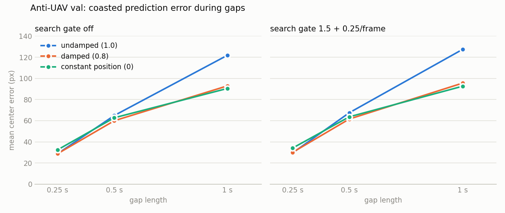

# Velocity damping while a track coasts

Run 2026-10-19 for #30. Same setup as [antiuav-search-gate.md](antiuav-search-gate.md): Anti-UAV **val** (67 clips, 20 fps), seed 0; MOT17 is the 7 train videos at 1280×736 with the dumped YOLO26n detections.

The change: each frame a track goes unmatched, its four velocities (center and size) are multiplied by `coast_damping` before the predict step, and the covariance with them (P ← DPD). Matched frames are untouched. 1 is the old constant-velocity coast, 0 freezes the box at its last prediction (the constant-position null). `tether-track --coast-damping D`.

**Result: it is in the code but off by default (1.0).** Damping only pays on Anti-UAV with the #29 gate on, and the gate is itself off by default because of MOT17. With the default, track files are byte-identical to main's on all 81 files checked (every MOT17 detection file at both input sizes, plus the val 20%-deletion files).

## Prediction error vs. gap length



Mean center distance between the held track's prediction and the drone, over every labeled gap frame.

| Damping | Gate | 0.25 s | 0.5 s | 1 s |
|---|---|---|---|---|
| 1.0 (undamped, main) | off | 28.8 px | 64.9 px | 121.9 px |
| 0.95 | off | 28.4 px | 62.1 px | 106.3 px |
| 0.9 | off | **28.3 px** | 61.0 px | 97.5 px |
| 0.8 | off | 28.8 px | **60.0 px** | 93.0 px |
| 0.6 | off | 29.5 px | 60.4 px | 90.4 px |
| 0.3 | off | 31.3 px | 61.9 px | **90.2 px** |
| 0 (constant position) | off | 32.5 px | 62.8 px | 90.5 px |
| 1.0 (undamped) | 1.5 + 0.25 | 29.6 px | 67.5 px | 127.4 px |
| 0.95 | 1.5 + 0.25 | **29.4 px** | 65.0 px | 110.6 px |
| 0.9 | 1.5 + 0.25 | 30.1 px | 63.4 px | 102.4 px |
| 0.8 | 1.5 + 0.25 | 30.1 px | **61.6 px** | 95.5 px |
| 0.6 | 1.5 + 0.25 | 31.5 px | 61.8 px | 94.4 px |
| 0.3 | 1.5 + 0.25 | 32.8 px | 62.8 px | 93.0 px |
| 0 (constant position) | 1.5 + 0.25 | 34.1 px | 63.7 px | **92.6 px** |

Each row averages over slightly different held tracks (1194–1228 of 1273 gaps at 0.25 s), so differences of a pixel or two are not meaningful.

- **Null check: constant position ties the best damping at 1 s and is within 3 px at 0.5 s.** Past about half a second the velocity estimate is useless; freezing the box is as good as anything. The velocity only earns its keep in the first few frames (0.25 s: 28–29 px with velocity vs. 32.5 px without).
- **Mild damping (0.8–0.9) is the best compromise for the prediction itself:** close to undamped at 0.25 s, best at 0.5 s, and 25–30 px better than undamped at 1 s.

## Recovery and ID kept

| Damping | Gate | ID kept 0% | ID kept 20% | 0.25 s gaps | 0.5 s gaps | 1 s gaps |
|---|---|---|---|---|---|---|
| 1.0 (main) | off | 48.3% | 30.5% | 72.7% | 54.4% | 31.3% |
| 0.95 | off | | | 74.0% | 52.9% | 30.4% |
| 0.9 | off | 48.5% | 33.2% | 73.9% | 47.8% | 29.4% |
| 0.8 | off | 49.1% | 33.9% | 70.2% | 44.1% | 30.5% |
| 0 | off | | | 58.5% | 39.2% | 31.9% |
| 1.0 | 1.5 + 0.25 | 60.8% | 61.1% | 92.0% | 87.6% | 88.4% |
| 0.95 | 1.5 + 0.25 | | | 92.4% | 88.5% | 92.8% |
| 0.9 | 1.5 + 0.25 | 62.6% | 63.4% | 92.3% | 88.5% | 93.9% |
| 0.8 | 1.5 + 0.25 | 63.2% | 63.7% | 92.0% | 87.7% | 94.3% |
| 0.6 | 1.5 + 0.25 | | | 91.3% | 88.5% | 94.3% |
| 0.3 | 1.5 + 0.25 | | | 91.5% | 88.8% | 94.8% |
| 0 | 1.5 + 0.25 | **63.5%** | **64.0%** | 90.7% | 88.2% | **94.7%** |
| SPEC target | | — | at least 95% | — | — | at least 80% |

Blank cells weren't run. Gap columns are recovery over 1196–1228 (0.25 s), 1057–1080 (0.5 s) and 865–898 (1 s) held gaps.

- **Without the gate, damping hurts.** 0.5 s recovery falls from 54.4% to 44.1% at 0.8 and 39.2% at 0, even though the mean prediction error at 0.5 s is lower. Without the gate a coasted track can only be re-matched by IoU, and the undamped prediction lands on the drone more often when it does land, which a mean distance doesn't show. 20% deletion gains 3 points, which doesn't change the picture.
- **With the gate, damping helps.** 1 s recovery rises from 88.4% to 93.9% (0.9) and 94.7% (0), and ID kept at 20% deletion from 61.1% to 63.4–64.0%. The gate is centered on the prediction, so a prediction that doesn't run off keeps the drone inside it.
- **Distance to the targets (best row, gate + constant position): ID kept 64.0% vs. 95%, 31 points short. 1 s recovery 94.7% vs. 80%, met.** ID kept is still the open problem.
- **Where the breaks moved (`handover.py`, 20% deletion, gate on).** Distinct IDs holding the drone fall from 685 (undamped) to 497 (0.8) and 420 (0). Handovers while the old holder had missed 2–5 frames fall from 480 to 420 and 405, a smaller drop than hoped, while handovers after a single missed frame rise from 162 to 392 and 519. Fewer IDs but more handovers means the drone flips back and forth between the same two IDs more often. Not investigated: our guess is that a damped prediction lags a fast drone after one miss, a new tentative track picks it up, and the gate later hands it back.

## MOT17

| Tracker | HOTA | IDF1 | ID switches |
|---|---|---|---|
| main (no gate, undamped) | 41.29 | 49.04 | 748 |
| damping 0.9 | 41.10 | 48.87 | 746 |
| damping 0.8 | 41.56 | 49.06 | 771 |
| damping 0 | 41.45 | 49.55 | 852 |
| gate 1.5 + 0.25, undamped | 38.88 | 44.92 | 1261 |
| gate 1.5 + 0.25, damping 0.9 | 36.50 | 41.95 | 1318 |

- **Alone, damping is roughly neutral on MOT17:** HOTA within ±0.3 for 0.8–0.9, but ID switches grow as damping gets stronger (+104 at 0). Pedestrians move steadily, so their velocity is worth keeping.
- **With the gate, damping makes MOT17 worse still** (HOTA 38.88 → 36.50). A prediction that stays put is a gate centered where the person was, which is closer to whoever walked into that spot.

So the setting that is best on Anti-UAV (gate + strong damping) is the worst on MOT17. Same lesson as #29: on Anti-UAV a wrong match is impossible, so it always rewards looser association, and MOT17 is the only check against it.

## Reproduce

```
tether-antiuav data/Anti-UAV300 --split val --work-dir results/antiuav-val/damp-0.8-gate --name damp-0.8-gate \
    --tracker "tether-track --coast-damping 0.8 --search-gate 1.5 --search-gate-growth 0.25"
tether-mot17 data/MOT17 --model models/yolo26n_1280x736.onnx --name damp-0.8_yolo26n_1280x736 \
    --tracker "tether-track --coast-damping 0.8"
```

The gap sweep (all seven damping values) ran first through a scratch monkeypatch of the same change; a run through `--coast-damping 0.9` with the gate reproduced its 1 s row exactly (93.9%, 102.4 px).
